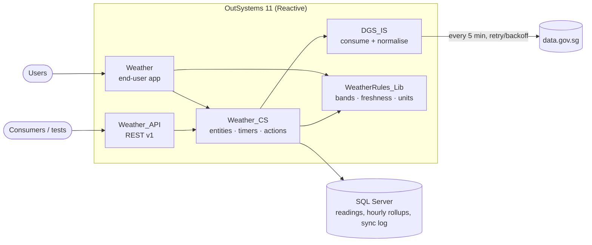
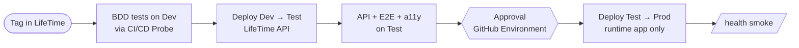

# SG Weather Insights

An OutSystems 11 Reactive Web application for exploring Singapore's real-time weather and air
quality, built on NEA's open APIs from [data.gov.sg](https://data.gov.sg). It ingests seven
feeds every five minutes into a local time series, and lets users see conditions island-wide
on a map, find and compare stations, drill into trends from 6 hours to 30 days, and check
regional PSI / PM2.5 with NEA health bands.

This repository holds everything outside the OutSystems platform: architecture and
decisions, the implementation spec for the OutSystems modules, the public API contract,
Terraform for a self-managed OutSystems 11 factory on AWS, automated tests at every layer,
and CI/CD.

| | |
|---|---|
| **Live app** | `https://<your-environment>/Weather/` — access details provided separately |
| **API** | `https://<your-environment>/Weather_API/rest/v1` — contract in [`outsystems/api/weather-api.openapi.yaml`](outsystems/api/weather-api.openapi.yaml) |
| **Data** | `api-open.data.gov.sg/v2/real-time/api/` — air-temperature, relative-humidity, wind-speed, wind-direction, rainfall, psi, pm25 |

## Contents

| Path | What it is |
|---|---|
| [`docs/architecture.md`](docs/architecture.md) | Context, module layering, ingestion design, data model, screens, AWS deployment |
| [`docs/adr/`](docs/adr) | Decisions with alternatives and consequences |
| [`docs/outsystems-build-guide.md`](docs/outsystems-build-guide.md) | Module-by-module implementation spec (entities, actions, SQL, timers, screens, test IDs) |
| [`docs/walkthrough.md`](docs/walkthrough.md) | Demo script and design trade-offs for the review session |
| [`outsystems/api/`](outsystems/api) | OpenAPI 3 contract of the exposed REST API |
| [`infra/terraform/`](infra/terraform) | IaC for LifeTime / Dev / Test / Prod on AWS ([README](infra/terraform/README.md)) |
| [`tests/`](tests) | Contract, rules, normalisation, API, E2E, accessibility, BDD specs, upstream stub, load |
| [`.github/workflows/`](.github/workflows) | CI, IaC checks, OutSystems delivery pipeline, nightly upstream drift check |

## Architecture in one page



* **Ingest, don't proxy.** One upstream call per feed per five minutes regardless of traffic,
  so rate limits never scale with users, outages degrade to "stale" rather than "blank",
  and history beyond the API's latest-reading default is available for trends.
* **Idempotent by construction.** A unique key on station + metric + timestamp and a
  set-based `MERGE` make re-runs, overlaps and backfills safe.
* **Rules in one place.** Banding, freshness, unit and compass rules live in a pure library
  used on both client (map colours) and server (API), driven by shared test vectors.
* **Observable.** Every sync writes a `SyncRun`; `/health`, the admin screen, the UI stale
  banner and a CloudWatch alarm all read from it.

## Running the tests

```bash
make install
make test                    # offline: upstream contract on fixtures, rule vectors, normaliser, API spec
make test-live               # same schemas against the real data.gov.sg API
WEATHER_API_BASE_URL=https://<host>/Weather_API/rest/v1 make test-api
WEATHER_APP_URL=https://<host>/Weather/ make e2e          # Playwright + axe, desktop + mobile
make tf-test                 # terraform fmt/validate/test (mocked AWS), tflint, checkov
make stub                    # WireMock data.gov.sg stub for the OutSystems BDD integration suite
```

| Layer | Where | When it runs |
|---|---|---|
| Upstream contract (JSON Schema) | `tests/contract` | every push (fixtures), nightly (live, opens an issue on drift) |
| Business rules (shared vectors) | `tests/vectors`, `tests/reference`, BDD `rules.feature` | every push; inside OutSystems on every tag |
| Ingestion + resilience (BDD Framework) | `tests/bdd/*.feature` → `Weather_Tests` | pipeline, on Development via CI/CD Probe |
| API contract | `tests/api` | every push (spec), after deploy to Test (live) |
| UI journeys + WCAG 2.1 AA | `tests/e2e` | after deploy to Test |
| Load | `tests/load/smoke.js` (k6) | on demand |
| Infrastructure | `infra/terraform/modules/*/tests` | every push touching `infra/` |

## Delivery pipeline



Uses [`outsystems-pipeline`](https://github.com/OutSystems/outsystems-pipeline) for LifeTime
and BDD orchestration. The test application is never part of the Prod deployment plan.
Required repository secrets: `LIFETIME_URL`, `LIFETIME_TOKEN` (LifeTime service account),
`DEV_URL`, `TEST_API_URL`, `TEST_APP_URL`, `PROD_API_URL`, optional `DGS_API_KEY`.

## Infrastructure

Terraform provisions a self-managed OutSystems 11 factory in `ap-southeast-1`: separate
non-prod and prod VPCs (peered for LifeTime), per-environment RDS SQL Server, Windows
servers bootstrapped with `Outsystems.SetupTools`, ALB with admin-path restrictions, WAF on
Prod, Secrets Manager with write-only secrets (nothing sensitive in state), SSM-only access,
CloudWatch logs/alarms, and GitHub OIDC for CI. Production guard-rails (Multi-AZ, deletion
protection, ≥ 2 front-ends, dedicated controller) are enforced as plan-time preconditions and
covered by `terraform test`. Details and runbook: [`infra/terraform/README.md`](infra/terraform/README.md).

## Assumptions

* **Demo vs target platform.** The demo build runs on an OutSystems-hosted O11 environment;
  the Terraform describes the production target. The application is identical on both
  (ADR 0001).
* **Freshness over completeness.** Five-minute ingestion is fresh enough for weather; the UI
  always states "as of" time. Raw readings are kept 7 days and hourly aggregates 400 days.
* **Anonymous access.** The data is open and the app holds no personal data, so public
  screens need no login; operational actions require the `WeatherAdmin` role.
* **Upstream shapes** were verified against live responses on 2026-10-20 and are pinned as
  fixtures; the nightly job detects drift.
* **Time.** All stored times are server-local; servers and the database run in Singapore
  time (no DST), with a site property to correct for UTC-based environments.

## Trade-offs and what I would do next

| Chose | Over | Because | Revisit when |
|---|---|---|---|
| Local store + timers | Live proxy | Rate limits, history, resilience | Never for this use case |
| `LatestReading` denormalisation | Window query each time | Dashboard is the hottest path | Read volume is low enough not to matter |
| Single `MERGE` via `OPENJSON` | Entity actions per row | One statement per batch instead of one per row (rainfall alone is ~90 rows every 5 min) | Moving to a non-SQL Server DB |
| Self-managed O11 on AWS | ODC | Brief asks for platform IaC | Organisation adopts ODC |
| Separate RDS per environment | Shared non-prod RDS | Isolation, simple restore | Cost pressure (documented lever) |
| Plain Terraform + var files | Terragrunt / workspaces | Explicit, fewer tools | More accounts/regions |

Next steps: forecast endpoints (2-hour / 24-hour) alongside observations; station-level
anomaly flags (value outside 3σ of its own hourly history); push alerts when PSI crosses a
band; Transit Gateway if more VPCs join; scheduled non-prod shutdown.

## Data licence

Contains information from Realtime Weather Readings and PSI/PM2.5 datasets accessed from
data.gov.sg, made available under the terms of the
[Singapore Open Data Licence version 1.0](https://data.gov.sg/open-data-licence).
