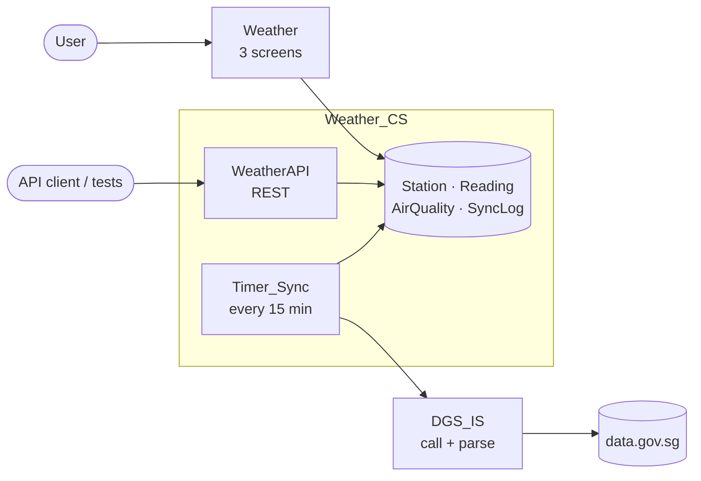

# SG Weather Insights

An OutSystems 11 Reactive Web app for exploring Singapore's real-time weather and air quality
from [data.gov.sg](https://data.gov.sg) (NEA real-time APIs). Users pick a metric (temperature,
humidity, wind, rainfall), see island-wide min/avg/max and every station's latest value,
search and sort stations, open a station to chart its last 24 hours to 7 days, and check
today's PSI by region with NEA health bands.

| | |
|---|---|
| **App** | `https://<your-environment>/Weather/` (access details provided separately) |
| **API** | `https://<your-environment>/Weather_CS/rest/WeatherAPI` — [OpenAPI contract](outsystems/api/weather-api.openapi.yaml) |
| **Data** | `api-open.data.gov.sg/v2/real-time/api/` — air-temperature, relative-humidity, wind-speed, rainfall, psi |

## Design



Three modules following the OutSystems 4-layer canvas:

| Module | Layer | Responsibility |
|---|---|---|
| `DGS_IS` | Foundation | Calls data.gov.sg and parses the JSON into simple lists. Parsing is a separate action, so tests run on saved JSON without the network. |
| `Weather_CS` | Core | Entities, the sync timer, read actions, PSI banding, the exposed REST API. |
| `Weather` | End-user | Dashboard, Station detail, Air quality. |

Key decisions:

* **Store, don't proxy.** A timer pulls 5 feeds every 15 minutes into the database. Upstream
  load is fixed no matter how many users there are (no rate-limit problems), the app keeps
  working if data.gov.sg is down, and charts have history (the API only returns the latest
  reading). Trade-off: data is up to 15 minutes old, shown as "As of HH:mm".
* **Idempotent sync.** A batch whose timestamp is already stored is skipped, and a unique
  index on (station, metric, time) prevents duplicates if runs ever overlap.
* **One feed failing doesn't stop the others.** Each feed is committed separately and every run
  is written to `SyncLog`.
* **Bounded storage.** Each sync also deletes readings older than 7 days.
* **Accessible.** PSI bands are written out, not shown by colour alone; WCAG 2.1 AA checked by
  automated tests.

Build steps: [`docs/build-guide.md`](docs/build-guide.md).

## Tests

| What | Where | Runs |
|---|---|---|
| Upstream contract — data.gov.sg responses match the JSON Schemas we rely on | `tests/contract` | every push (saved fixtures), daily (live API) |
| PSI band rule — shared vectors also used by the OutSystems test | `tests/vectors`, `tests/reference` | every push |
| Business logic in OutSystems (BDDFramework) — parsing, error handling, banding, idempotency | `tests/bdd.md` → `Weather_Tests` | in the OutSystems environment |
| REST API — schema, consistency, 400/404 handling, NEA bands | `tests/api` | when `WEATHER_API_BASE_URL` is set |
| UI journeys + accessibility (Playwright + axe) | `tests/e2e` | when `WEATHER_APP_URL` is set |
| Infrastructure — security and Prod guard-rails, mocked AWS | `infra/terraform/tests` | every push to `infra/` (+ tflint, Checkov) |

```bash
make install && make test                                   # offline suite
WEATHER_API_BASE_URL=https://<host>/Weather_CS/rest/WeatherAPI make test-api
WEATHER_APP_URL=https://<host>/Weather/ make e2e
make tf-test
```

To run the API and UI tests in CI, set repository variables `WEATHER_API_BASE_URL` and
`WEATHER_APP_URL`.

## Infrastructure

`infra/terraform` provisions one self-managed OutSystems 11 environment on AWS: VPC with
private subnets, RDS SQL Server, a Deployment Controller plus a front-end Auto Scaling group,
an HTTPS load balancer that blocks Service Center/LifeTime from the public, Secrets Manager
(passwords never in Terraform state), KMS encryption, SSM access instead of RDP, and alarms.
Run it per environment with `envs/<env>.tfvars`. Details: [`infra/terraform/README.md`](infra/terraform/README.md).

## Assumptions

* The demo runs on an OutSystems-hosted O11 environment; the Terraform describes how the
  platform would run on AWS. The application is the same on both.
* The data is public and the app stores no personal data, so screens need no login.
* Times are stored in Singapore time (the servers and database run in Singapore time; on a UTC
  server the parse step would add 8 hours).
* data.gov.sg response shapes were verified on 2026-10-20 and saved as fixtures; the daily
  live contract test catches changes.

## Left out on purpose (next steps)

Map view, 2-hour forecasts, backfilling past days, retry with backoff (a failed feed simply
retries on the next run), hourly rollups for longer history, a LifeTime/CI deployment
pipeline, WAF and extra logging on the AWS side. A more extensive version of the design is on
the [`extended-design`](https://github.com/PradheepAls/sg-weather-insights/tree/extended-design) branch.

## Data licence

Contains information from data.gov.sg made available under the terms of the
[Singapore Open Data Licence version 1.0](https://data.gov.sg/open-data-licence).
