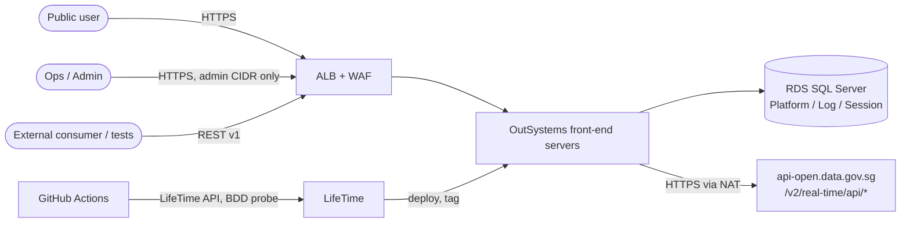
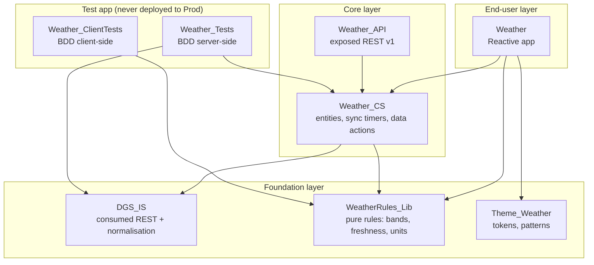
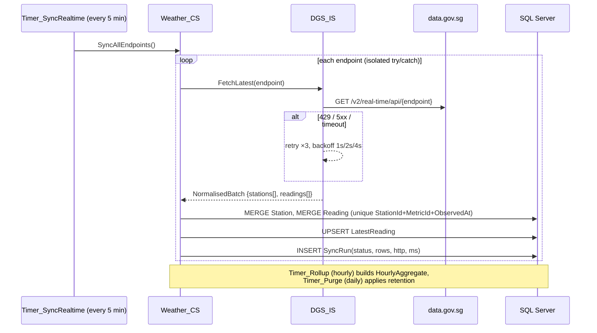
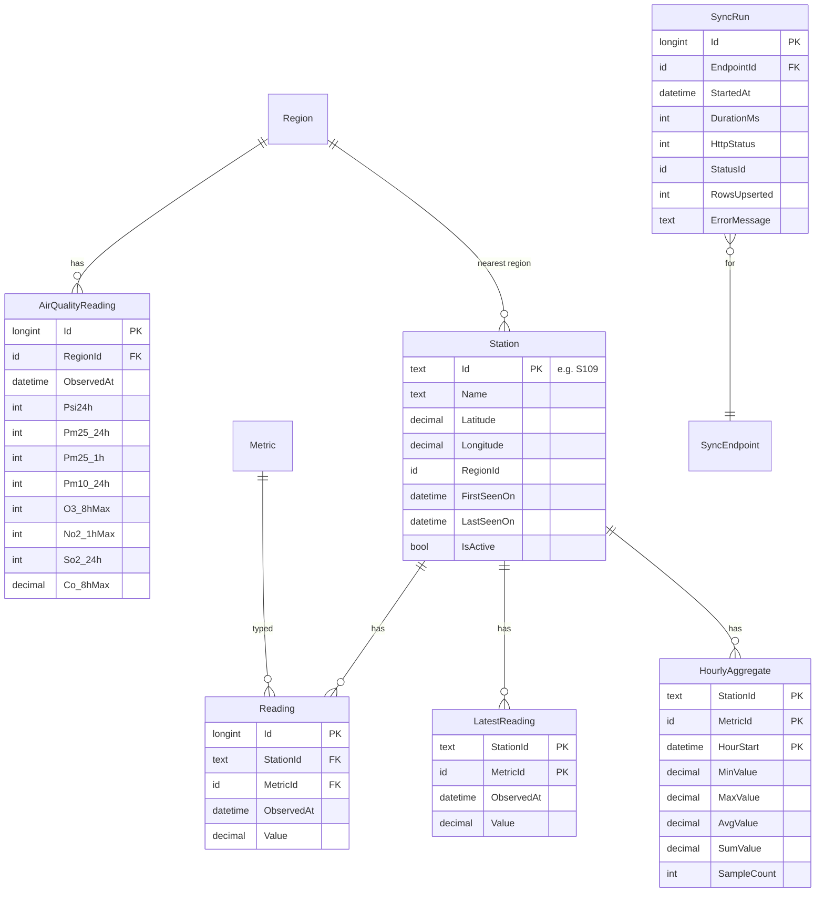
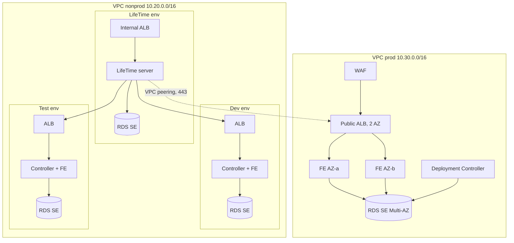

# Architecture

SG Weather Insights is an OutSystems 11 Reactive Web application that ingests NEA's real-time
weather and air-quality feeds from data.gov.sg, stores them as a time series, and lets users
explore conditions across Singapore by station, region, metric and time window.

## 1. Context

## 2. Data source

All seven endpoints are under `https://api-open.data.gov.sg/v2/real-time/api/`. Shapes were
confirmed against live responses on 2026-10-20 and are frozen as fixtures in
`tests/contract/fixtures/`.

| Endpoint | Grain | Unit (`readingUnit`) | Cadence | Shape |
|---|---|---|---|---|
| `air-temperature` | station | `deg C` | 1 min | stations + readings |
| `relative-humidity` | station | `percentage` | 1 min | stations + readings |
| `wind-speed` | station | `knots` | 1 min | stations + readings |
| `wind-direction` | station | degrees | 1 min | stations + readings |
| `rainfall` | station (~90 gauges) | `mm` (5-min total) | 5 min | stations + readings |
| `psi` | region (5) | PSI / µg/m³ | hourly | regionMetadata + items[].readings{metric:{region:value}} |
| `pm25` | region (5) | µg/m³ | hourly | regionMetadata + items[].readings |

Behaviour that shapes the design:

* No `date` → latest reading only. `date=YYYY-MM-DD` → the full day, newest first, paged with
  `data.paginationToken` (pass back as `?paginationToken=`). This is the backfill path.
* Station lists differ per metric (rainfall has ~90 gauges, temperature ~18) and stations appear
  and disappear (e.g. `S199` with no name). Stations are therefore upserted from every response,
  never seeded.
* Optional `x-api-key` header raises rate limits; anonymous calls can receive HTTP 429.
* Envelope is `{code, data, errorMsg}`; `code != 0` is an application error even on HTTP 200.

## 3. Logical architecture (Architecture Canvas)

Rules enforced: no upward references, no side references between end-user modules, the
integration module exposes only normalised structures (raw API structures stay private), and
the rules library has no entities so it can be used client-side (band colours) and server-side
(API responses) from one implementation.

## 4. Ingestion design

Key properties:

* **Idempotent.** Unique index on `(StationId, MetricId, ObservedAt)` plus a SQL `MERGE` means
  re-running a sync, overlapping timers, or a backfill over the same day never duplicates rows.
* **Failure isolation.** Each endpoint is synced in its own transaction (`CommitTransaction`
  after each), so a PSI outage does not block temperature.
* **Observable.** Every run writes a `SyncRun` row. The admin screen and `/health` expose
  per-endpoint freshness; the UI shows a "data may be stale" banner when the newest reading is
  older than the endpoint's threshold (15 min for 1-min feeds, 2 h for hourly feeds).
* **Bounded storage.** Raw readings kept 7 days; hourly aggregates kept 400 days. At ~18
  stations × 4 one-minute metrics + 90 gauges every 5 min the raw table holds roughly 1.6 M rows
  per week, comfortably within SQL Server with the indexes in §5.

### Why store instead of proxying the API live

| Option | Pros | Cons | Decision |
|---|---|---|---|
| Live proxy on each screen | No storage, always fresh | Rate limits × user count, no history beyond what the API pages, slow aggregates, outage = blank UI | Rejected |
| Client-side fetch from browser | Zero server load | Exposes API key, CORS, no history | Rejected |
| **Scheduled ingestion + local store** | One upstream call per endpoint per 5 min regardless of users, history and aggregation in SQL, UI survives outages | Up to 5 min staleness, storage and retention to manage | **Chosen** |

## 5. Data model

Static entities: `Metric` (AirTemperature, RelativeHumidity, WindSpeed, WindDirection,
Rainfall, with unit and display precision), `Region` (North, South, East, West, Central, with
label coordinates), `SyncEndpoint`, `SyncStatus`.

Indexes: `Reading(StationId, MetricId, ObservedAt)` unique; `Reading(MetricId, ObservedAt)`
for island-wide snapshots; `AirQualityReading(RegionId, ObservedAt)` unique.

`LatestReading` is a deliberate denormalisation: the dashboard is the hottest query and
"latest per station per metric" over a 1.6 M-row table is a windowed scan; one indexed lookup
of ~180 rows is not.

## 6. Exposed API (`Weather_API`, REST v1)

Specified in `outsystems/api/weather-api.openapi.yaml`. Read-only, anonymous, cached
(`Cache-Control: max-age=60`), consistent error envelope, ISO-8601 timestamps with `+08:00`.
The Reactive app does **not** call this API (it uses data actions in `Weather_CS` directly);
the API exists for external consumers and as the black-box surface for automated tests, and
it calls the same `Weather_CS` server actions, so testing the API exercises the same logic the
screens use.

## 7. Front-end

| Screen | Purpose | Interaction |
|---|---|---|
| Dashboard | "What is it like right now?" | Metric switcher (temp / humidity / wind / rain), Leaflet map with value-labelled markers, island min/avg/max cards, freshness badge, 5-min auto-refresh |
| Stations | Find and compare stations | Search by name/ID, filter by region and metric, sortable columns, server-side paging, CSV export |
| Station detail | Trend at one place | Line chart with 6 h / 24 h / 7 d / 30 d range (raw for ≤24 h, hourly aggregate beyond), overlay island average, min/max annotations |
| Air quality | Regional PSI & PM2.5 | Region cards with NEA band and advisory text, 24 h trend, sub-index table |
| Admin (role `WeatherAdmin`) | Operate ingestion | Per-endpoint last run / status / rows, run sync now, backfill a date |

Accessibility: bands are conveyed by label and icon as well as colour, chart data is also
available as a table, all interactive elements are keyboard reachable, colour tokens meet
WCAG AA contrast in light and dark themes. Every element used by E2E tests carries a
`data-testid` attribute (set in Service Studio → Attributes).

## 8. Deployment architecture (AWS, self-managed O11)

See `infra/terraform/README.md` for the full resource inventory.

Principles: private subnets for all servers and databases, no inbound RDP/SSH (SSM Session
Manager only), IMDSv2 enforced, KMS encryption for EBS/RDS/secrets/logs, Service Center and
LifeTime paths blocked on the public listener except from admin CIDRs, separate VPC and
database per production environment.
