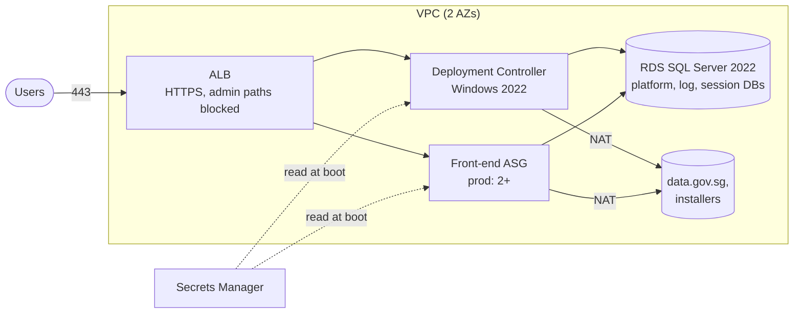

# Infrastructure — OutSystems 11 environment on AWS

One Terraform root that provisions one self-managed OutSystems 11 environment. Run it once
per environment (dev, test, prod, or lifetime), each with its own var file and state.



| File | What it creates | Why |
|---|---|---|
| `network.tf` | VPC, 2 public + 2 private subnets, NAT, routes | Servers and DB are never public; outbound via NAT |
| `security.tf` | 3 security groups (ALB, servers, DB) | Only ALB→servers:443 and servers→DB:1433; no RDP/SSH |
| `kms.tf` | One customer-managed key | Encrypts disks, database, secrets, alarm topic |
| `secrets.tf` | DB logins, RabbitMQ credentials, shared `private.key` | Passwords are ephemeral + write-only, so they never appear in state |
| `database.tf` | RDS SQL Server SE 2022 | Encrypted, private, RDS-managed master password, backups; Prod must be Multi-AZ |
| `compute.tf` | Controller instance, front-end ASG, launch templates | Controller is a single named server with auto-recovery; front-ends scale and self-heal |
| `templates/bootstrap.ps1.tftpl` | First-boot script | Creates the DB catalogs/logins, installs the pinned Platform Server, configures it, shares `private.key`, installs the licence |
| `alb.tf` | ALB, HTTPS listener, admin-path rules | TLS 1.2+, HTTP→HTTPS, `/ServiceCenter` and `/LifeTime` return 403 outside admin networks |
| `monitoring.tf` | SNS topic + alarms | Unhealthy server, 5xx, DB CPU, DB storage, controller hardware recovery |

Production guard-rails are **plan-time preconditions**: a Prod plan fails without a
Multi-AZ database, deletion protection, 14+ days of backups and at least two front-ends.

## Use

Prerequisites: Terraform ≥ 1.11, AWS credentials, an S3 bucket for state, an ACM
certificate, and the OutSystems licence file uploaded to S3.

```bash
cd infra/terraform
terraform init -backend-config="bucket=<state-bucket>" -backend-config="key=sgw/dev.tfstate" \
               -backend-config="region=ap-southeast-1" -backend-config="use_lockfile=true"
terraform plan  -var-file=envs/dev.tfvars
terraform apply -var-file=envs/dev.tfvars
```

After apply: wait ~40 minutes for the bootstrap (log at `C:\ProgramData\sgw\bootstrap.log`,
reach the server with `aws ssm start-session --target <controller_instance_id>`), change the
Service Center admin password, then register the environment in LifeTime using the
`controller_private_ip` output.

## Tests

```bash
terraform init -backend=false && terraform test   # offline, mocked AWS provider
```

The tests check encryption, a private DB, IMDSv2, no RDP/SSH, admin paths blocked, the pinned
version in the bootstrap, user data under 16 KB, the Prod shape, and that unsafe Prod
settings make the plan fail. CI also runs `tflint` and Checkov.

## Simplifications (and what I'd add for a real factory)

* One NAT gateway → one per AZ in Prod.
* No WAF → add AWS WAF (managed rules + rate limit) on the Prod ALB.
* No VPC flow logs, ALB access logs or CloudWatch agent → add for audit and troubleshooting.
* Separate VPC per environment and no peering → LifeTime needs a network path to each
  environment (VPC peering or Transit Gateway).
* `Outsystems.SetupTools` cmdlet names and `server.hsconf` setting names follow the module's
  documentation; verify against the pinned version before first use.
